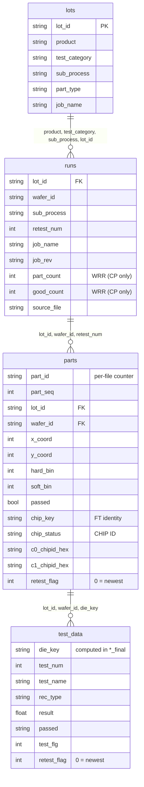

# stdf テーブルスキーマ

STDFファイルをParquet形式に変換した際のテーブル定義。  
DuckDBビュー経由でSQLクエリ可能。

Parquet テーブルは `runs` / `parts` / `test_data` の 3 つだけ。`lots` と `*_final` /
`wafer_yield_final` は DuckDB VIEW。

---

## パーティション構造

```
data/
└── {table}/
    └── product={product}/
        └── test_category={CP|FT}/
            └── sub_process={CP1|FT2|...}/
                └── lot_id={lot_id}/
                    └── wafer_id={id}/retest={n}/     ← runs / parts / test_data
                        └── data.parquet
```

> `lots` は Parquet を持たず `runs` から派生する DuckDB VIEW。3 テーブルとも `lot_id`
> の下に `wafer_id` / `retest` まで切る（FT はウェーハ概念が無いため `wafer_id=`（空）
> になる。`runs` は FT では lot 単位 = `wafer_id=''` ごとに 1 行）。`product` /
> `test_category` / `sub_process` / `lot_id` / `wafer_id` / `retest` は Hive パーティション
> 列として SELECT 可能。`retest_num` は同じ lot + wafer（+ sub_process）の何本目の
> ファイルかで、別ファイルを ingest するたびに増える。**同じ `source_file` を再 ingest
> すると自分の `retest_num` を上書き**する（行は増えない）。`.gz` は外した名前で記録するので、
> `X.stdf.gz` と展開済みの `X.stdf` は同じファイル扱い。
>
> ingest 中断はデータ直下の `_pending/` マーカーで検出し、ingest バッチの冒頭と末尾で
> `retest_flag` を再計算して復旧する（`ParquetStorage.recover_pending()`）。マーカーが
> 残っている間は `setup_views()` が警告を出す（`*_final` がリテスト分を二重に数えている可能性）。
> ingest バッチはデータディレクトリごとに 1 つずつ（OS ロック `.ingest.lock`。2 つ目は待つ）。

---

## 適用範囲（CP / FT）

| テーブル | CP | FT | 単位 / 備考 |
|---------|:--:|:--:|------|
| `runs` | ✓ | ✓ | CP は 1 wafer = 1 行、FT は 1 FT lot run（`wafer_id=''`）= 1 行。MIR / SDR メタデータと WRR 値（CP のみ） |
| `lots` | ✓ | ✓ | 1 lot（× sub_process）= 1 行。`runs` から集約した VIEW |
| `parts` | ✓ | ✓ | CP = ダイ / FT = パッケージ（1 PRR）。CHIP ID 列（`c0_*` / `c1_*`）は FT の 2-die パッケージで入る |
| `test_data` | ✓ | ✓ | パラメトリック測定（PTR/MPR/FTR） |

> **歩留りの算出元**: `runs.part_count` / `good_count` は WRR の報告値でリテスト時は部分
> 母集団、FT には無い。歩留りは **`parts_final`（最新の測定）から算出**する
> （`wafer_yield_final` / 名前付きクエリ `lot_yield` / `AnalysisSession.lot_summary()`）。
>
> **sub_process を混ぜない**: 同じロットの CP1 / CP2（FT1 / FT2）は別の測定。dedup も
> yield も `(product, test_category, sub_process, lot_id, wafer_id)` ごとに閉じており、
> ロット単位に集計・結合するクエリは `sub_process`（必要なら `test_category` /
> `product`）を GROUP BY / JOIN キーに含めること。

---

## runs

**1 STDF ファイル × wafer identity = 1 行**の MIR/MRR メタデータ。CP はファイル中の
wafer ごとに 1 行（1 ファイルに複数 wafer が入っていれば同じ `source_file` の複数行に
なる）、FT は `wafer_id=''` として **FT lot run 単位**（= ファイル単位）に 1 行。
`lots` はこのテーブルから集約した VIEW（下記参照）で、Parquet として書かれる実体は
`runs` だけ。WRR のウェーハ別カウンタ・時刻も `runs` の列（旧 `wafers` テーブルは無い）。

| 列名 | 型 | ソース | 説明 |
|------|----|--------|------|
| lot_id | STRING | MIR.LOT_ID | ロットID |
| wafer_id | STRING | WIR.WAFER_ID | ウェーハID（FT は空） |
| product | STRING | CLI / パス | 製品名 |
| test_category | STRING | sub_process から導出 | `CP` / `FT` / `OTHER` |
| sub_process | STRING | MIR.TEST_COD | 小工程（CP1, FT2 等） |
| retest_num | INT64 | 自動算出（`wafer_retest_map`） | リテスト番号（0=初回, 1,2...=リテスト）。`parts` / `test_data` と同じキーで join できる |
| part_type | STRING | MIR.PART_TYP | 品種名 |
| job_name | STRING | MIR.JOB_NAM | テストプログラム名 |
| job_rev | STRING | MIR.JOB_REV | テストプログラムリビジョン |
| start_time | TIMESTAMP(ms, UTC) | MIR.START_T | テスト開始時刻 |
| finish_time | TIMESTAMP(ms, UTC) | MRR.FINISH_T | テスト終了時刻 |
| tester_type | STRING | MIR.TSTR_TYP | テスター種別 |
| operator | STRING | MIR.OPER_NAM | オペレータ名 |
| node_name | STRING | MIR.NODE_NAM | テスター号機名（`tester_type` は機種） |
| handler_type | STRING | SDR.HAND_TYP | ハンドラ／プローバ機種 |
| handler_id | STRING | SDR.HAND_ID | ハンドラ／プローバ号機 |
| probe_card_type | STRING | SDR.CARD_TYP | プローブカード機種 |
| probe_card_id | STRING | SDR.CARD_ID | プローブカード ID |
| loadboard_type | STRING | SDR.LOAD_TYP | ロードボード機種 |
| loadboard_id | STRING | SDR.LOAD_ID | ロードボード ID |
| socket_type | STRING | SDR.CONT_TYP | ソケット（コンタクタ）機種 |
| socket_id | STRING | SDR.CONT_ID | ソケット（コンタクタ）ID |
| wafer_start_time | TIMESTAMP(ms, UTC) | WIR.START_T | ウェーハのテスト開始時刻（CP のみ。FT は NULL） |
| wafer_finish_time | TIMESTAMP(ms, UTC) | WRR.FINISH_T | ウェーハのテスト終了時刻（CP のみ） |
| part_count | INT64 | WRR.PART_CNT | テスタ報告の総ダイ数（CP のみ。複数ヘッドは合算） |
| good_count | INT64 | WRR.GOOD_CNT | テスタ報告の良品数（CP のみ） |
| rtst_count | INT64 | WRR.RTST_CNT | テスタ報告のリテスト数（CP のみ） |
| abrt_count | INT64 | WRR.ABRT_CNT | テスタ報告のアボート数（CP のみ） |
| test_rev | STRING | ファイル名 (Rev04等) | テストプログラムリビジョン（ファイル名由来。TP 判定には使わない） |
| source_file | STRING | CLI | 元STDFファイル名 |

> **TP（テストプログラム）の判定キーは `job_name` + `job_rev`（MIR 由来）のみ**。
> `test_rev` はファイル名から抽出した参考情報で判定には使わない。
> per-wafer の TP 一覧は `SELECT lot_id, wafer_id, retest_num, job_name, job_rev FROM runs`
> で直接引ける（`stdf db programs` も参照）。

> **設備情報（SDR 由来）の畳み込みルール**: SDR (1/80) は「ヘッド × サイトグループ」ごとに
> 1 レコードで、1 ファイルに複数入ることがある。`runs` は 1 ファイル × wafer identity = 1 行
> なので、各列は **ファイル内の全 SDR の非空値を重複除去・ソートしてカンマ連結**した値になる。
> 全 SDR が同値なら単一値（`SKT-01`）、本当に混在した場合だけ `SKT-A,SKT-B` と見える。
> SDR が無いファイルや途中で切れた SDR では、取れなかった列は空文字 `''`。
> CP ではハンドラ欄にプローバ、カード欄にプローブカードが入り、
> `loadboard_*` / `socket_*` は空になるのが一般的（設備側の出力次第）。

> **WRR 列は報告値**: リテスト実行時は再測定した部分母集団しか含まず、FT には存在しない
> （NULL）。歩留りには使わず、`wafer_yield_final`（`parts_final` から算出）を使う。

---

## lots

**`runs` 由来の VIEW**（Parquet ではない）。1 lot = 1 行に集約される。

```sql
CREATE OR REPLACE VIEW lots AS
SELECT lot_id, product, test_category, sub_process,
       arg_max(part_type,   start_time) AS part_type,
       arg_max(job_name,    start_time) AS job_name,
       arg_max(job_rev,     start_time) AS job_rev,
       MIN(start_time)  AS start_time,
       MAX(finish_time) AS finish_time,
       arg_max(tester_type, start_time) AS tester_type,
       arg_max(operator,    start_time) AS operator,
       COUNT(DISTINCT (job_name, job_rev))     AS job_variant_count,
       COUNT(DISTINCT (job_name, job_rev)) > 1 AS job_mixed
FROM runs
GROUP BY lot_id, product, test_category, sub_process
```

| 列名 | 型 | ソース | 説明 |
|------|----|--------|------|
| lot_id | STRING | MIR.LOT_ID | ロットID |
| product | STRING | CLI / パス | 製品名 |
| test_category | STRING | sub_process から導出 | `CP` / `FT` / `OTHER` |
| sub_process | STRING | MIR.TEST_COD | 小工程（CP1, FT2 等） |
| part_type | STRING | `runs` の最新 run の値 | 品種名 |
| job_name | STRING | `runs` の最新 run の値 | テストプログラム名 |
| job_rev | STRING | `runs` の最新 run の値 | テストプログラムリビジョン |
| start_time | TIMESTAMP(ms, UTC) | `MIN(runs.start_time)` | lot 内で最初の run の開始時刻 |
| finish_time | TIMESTAMP(ms, UTC) | `MAX(runs.finish_time)` | lot 内で最後の run の終了時刻 |
| tester_type | STRING | `runs` の最新 run の値 | テスター種別 |
| operator | STRING | `runs` の最新 run の値 | オペレータ名 |
| job_variant_count | INT64 | `COUNT(DISTINCT (job_name, job_rev))` | lot 内で異なる TP の版数 |
| job_mixed | BOOL | `job_variant_count > 1` | lot 内で TP が混在しているか |

> **意味が変わった点**（旧: 1 STDF ファイル = 1 行を上書きしていた頃との違い）:
> - `start_time` / `finish_time` は「lot 内の最初の run 〜 最後の run」になった
>   （旧: 最後に ingest したファイルの値という不定値）。
> - `job_name` / `job_rev` / `part_type` / `tester_type` / `operator` は
>   **「最新 run（`start_time` が最も新しい run）の値」**に定義が固定される
>   （旧: ingest した順序に依存する不定値）。lot 内で TP が変わったかどうかは
>   `job_mixed` / `job_variant_count` で判定する。TP 混在の詳細（どの wafer が
>   どちらの版か）は `runs` を直接引く（[docs/sample_queries.md](./sample_queries.md)
>   の TP 混在検出クエリ参照）。
> - `lot_id` join の fan-out は起きない（1 lot = 1 行の契約は維持）。

---

## parts

ダイ（チップ）単位の結果。

| 列名 | 型 | ソース | 説明 |
|------|----|--------|------|
| part_id | STRING | 自動生成 | `{lot_id}_{wafer_id}_{連番}`（ストリーム順。**ファイルごとに 0 から振り直されるため結合キーに使わない**） |
| part_seq | INT64 | PIR 順 | ファイル内の PIR の出現順。同じダイがファイル内に 2 回あれば大きい方が新しい |
| part_txt | STRING | PRR.PART_TXT | 2D バーコード（表示用。identity には使わない） |
| part_serial | STRING | PRR.PART_ID | テスタが書くユニットシリアル（表示用） |
| chip_key | STRING | eFuse（C0、無ければ C1） | FT パッケージの identity。`EF|<16 桁 hex>`。eFuse が無い、または同一ファイル内の複数 part が同じ値で C0/C1 の組が食い違うなら `''`（C0 と C1 が両方一致すれば同じパッケージの再挿入とみなし、key を残して後の part が勝つ） |
| lot_id | STRING | MIR.LOT_ID | ロットID |
| wafer_id | STRING | WIR.WAFER_ID | ウェーハID（FT は空） |
| head_num | INT64 | PIR.HEAD_NUM | ヘッド番号 |
| site_num | INT64 | PIR.SITE_NUM | サイト番号 |
| x_coord | INT64 | PRR.X_COORD | X座標（FT は -32768） |
| y_coord | INT64 | PRR.Y_COORD | Y座標（FT は -32768） |
| hard_bin | INT64 | PRR.HARD_BIN | ハードビン |
| soft_bin | INT64 | PRR.SOFT_BIN | ソフトビン |
| passed | BOOL | PRR.PART_FLG | 合否。PART_FLG 0x10（合否無効）のとき **NULL** |
| part_flg | INT64 | PRR.PART_FLG | 生のフラグ値 |
| test_count | INT64 | PRR.NUM_TEST | テスト実行数 |
| test_time | INT64 | PRR.TEST_T | テスト時間 (ms) |
| retest_num | INT64 | 自動算出 | リテスト番号（0=初回, 1,2...） |
| retest_flag | INT64 | 自動算出（ingest 時） | そのダイの出現順位。0 = 最新。`parts_final` は `retest_flag = 0` |
| c0_chipid_hex | STRING | GDR `EN-S0-CHIPID_R`（C0） | 64bit CHIP ID（`0x…`） |
| c0_origin_fab | STRING | デコード | `TSMC1` / `TSMC2` / … / `UNKNOWN` |
| c0_origin_lot | STRING | デコード | 出自 CP ロット（TSMC のみ 6 文字） |
| c0_origin_wafer | INT64 | デコード | 出自ウェーハ番号 |
| c0_origin_x / c0_origin_y | INT64 | デコード | 出自 X / Y 座標 |
| c1_chipid_hex, c1_origin_fab, c1_origin_lot, c1_origin_wafer, c1_origin_x, c1_origin_y | | GDR（C1） | C0 と同じ（2 つ目の die） |
| chip_status | STRING | 自動判定 | NULL = CHIP ID 無し / `complete` / `ambiguous`（C0 または C1 が複数）/ `missing C0` / `missing C1` / `missing C0, C1` |
| chip_warnings | STRING | 自動判定 | `; ` 区切りの警告（デコード不能・C0 と C1 が同値など）。問題なければ `''` |

> **CHIP ID は別テーブルではなく `parts` の列**（`chipid` テーブル / `chipid_final` /
> `chipid_package` は無い）。C0 / C1 は CHIP ID の GDR の後ろに来る suite GDR
> （`CHIPID_NRD0_C0` / `…_C1`、同じ part・同じ site、次の CHIP ID・PRR・64 GDR まで）で
> 判別する（出現順ではない。tester の site と die は別物）。見つからない候補は
> `chip_status` / `chip_warnings` に出る。`ambiguous` のときは最初の候補の値が入る。
> 候補ごとの詳細は `scripts/diag_chipid.py`。
> ビット配置: `EFUSE[0:4]`=fab, `[4:13]`=Y(9bit), `[13:22]`=X(9bit),
> `[22:27]`=wafer(5bit, 値-3), `[27:62]`=lot(CHAR1×1 + CHAR2×5), `[62:64]`=予備。

---

## test_data

テスト項目ごとの測定結果（PTR / MPR / FTR を統合）。

| 列名 | 型 | ソース | 説明 |
|------|----|--------|------|
| lot_id | STRING | MIR.LOT_ID | ロットID |
| wafer_id | STRING | WIR.WAFER_ID | ウェーハID |
| part_id | STRING | 自動生成 | ダイID（ファイル内連番。結合には `die_key` を使う） |
| part_seq | INT64 | `parts.part_seq` | ファイル内の PIR 順 |
| part_txt | STRING | PRR.PART_TXT | 2D バーコード（表示用） |
| part_serial | STRING | PRR.PART_ID | ユニットシリアル（表示用） |
| chip_key | STRING | `parts.chip_key` | FT パッケージ identity |
| x_coord | INT64 | PRR.X_COORD | X座標 |
| y_coord | INT64 | PRR.Y_COORD | Y座標 |
| test_num | INT64 | PTR/MPR/FTR.TEST_NUM | テスト番号 |
| test_name | STRING | PTR/MPR/FTR.TEST_TXT | テスト名 |
| rec_type | STRING | レコード種別 | `PTR` / `MPR` / `FTR` |
| lo_limit | FLOAT64 | PTR/MPR.LO_LIMIT | 下限規格値。OPT_FLAG が「下限なし/無効」なら **NULL**（以降のレコードに有効値があればそれで補完） |
| hi_limit | FLOAT64 | PTR/MPR.HI_LIMIT | 上限規格値（同上） |
| units | STRING | PTR/MPR.UNITS | 単位 |
| result | FLOAT64 | PTR/MPR.RESULT | 測定値。TEST_FLG 0x02（値無効）のとき **NULL** |
| passed | STRING | PTR/MPR/FTR.TEST_FLG | `P` / `F`。未実行（0x10）・合否無効（0x40）は **NULL** |
| test_flg | INT64 | PTR/MPR/FTR.TEST_FLG | 生のフラグ値 |
| retest_num | INT64 | 自動算出 | リテスト番号 |
| pin_num | INT64 | MPR.PMR_INDX | ピン番号（MPR のみ。PTR/FTR は NULL） |
| pin_name | STRING | PMR から解決 | ピン名（MPR のみ） |
| exec_seq | INT64 | 自動算出（ingest 時） | 同一 run 内でのキー出現順（0始まり）。ループ計測（例: OTP ダンプが 1 test_num に 512 PTR を書く）の各回を区別 |
| retest_flag | INT64 | 自動算出（ingest 時） | ダイの出現（run × part）の新しさ順位。`parts` と同じ値。0 = 最新。`test_data_final` は `retest_flag = 0` |

---

## 派生 VIEW

| VIEW | 定義 | 用途 |
|------|------|------|
| `lots` | `runs` の集約（上記） | ロット（× sub_process）一覧・TP 混在検出 |
| `parts_final` | `SELECT *, die_key FROM parts WHERE retest_flag = 0` | 最新測定のダイ/パッケージ |
| `test_data_final` | `SELECT *, die_key FROM test_data WHERE retest_flag = 0` | 最新測定の値（ループ計測は全行保持） |
| `wafer_yield_final` | `parts_final` の集計 + gross die（クエリ時） | 歩留り。`(product, test_category, sub_process, lot_id, wafer_id)` ごとに 1 行 |

`wafer_yield_final` の列: `product, test_category, sub_process, lot_id, wafer_id, probed, good,
total, unprobed, gd_fail_bin, yield_pct`。CP の `total = max(probed, products.<P>.gross_die)`、
`unprobed = total - probed`（`gd_fail_bin` に計上。config 未設定・FT は `total = probed`）。
`passed` が NULL（合否無効）のダイは `good` に数えない。

### retest 解決（ingest 時）

`storage._recompute_flags` が lot/wafer グループ（`product, test_category, sub_process,
lot_id, wafer_id`）ごとに `retest_flag` を `parts` と `test_data` の両方へ書く。
`*_final` はウィンドウ関数を使わない単純な述語なので Parquet スキャンまで押し込まれる
（ロット絞り込みが速い）。

- 同じダイの出現を **(run の MIR `start_time`, `retest_num`, `part_seq`) の新しい順**に並べる。
  測定時刻で決まり、ingest の順序には依存しない（古いファイルが後から来ても勝たない）。
  同一ファイル内で同じダイが 2 回出たら後の part が勝つ（FT は同じ C0+C1 の再挿入）。
- 順位は出現ごとに 1 つで、その part の `parts` 行と `test_data` 全行に同じ値が入る。
  **`test_data_final` は勝った出現の測定だけ**で、古い run の行で補わない（stop-on-fail で
  リテストが途中までしか測っていなければ、残りのテストはそのダイに無い）。1 出現のループ
  測定行は同じフラグを共有する（全行残る。区別は `exec_seq`）。
- ダイ identity（`mounts.die_key_expr()`）: CP は `(x_coord, y_coord)`。FT は eFuse の
  `chip_key`、無ければその run 固有の `NOEF|<retest_num>|<part_id>`（run をまたいで重ねない）。
  **バーコード（`part_txt` / `part_serial`）は identity に使わない。**
- `retest_flag IS NULL`（フラグ導入前のファイル）の行は `*_final` から除外される。
  ストアの wipe + 再 ingest が必要（移行パスは無い）。

### die_key

`parts_final` / `test_data_final` には **`die_key`** 列が付く（Parquet には保存せず、
ビューが計算する）。CP は `CP|{x}|{y}`、FT は `FT|{chip_key}`（eFuse が無ければ
`FT|NOEF|{retest_num}|{part_id}`）。**両ビューを結合するときは `part_id` ではなく**

```sql
p.product = td.product AND p.test_category = td.test_category
AND p.sub_process IS NOT DISTINCT FROM td.sub_process
AND p.lot_id = td.lot_id AND p.wafer_id = td.wafer_id AND p.die_key = td.die_key
```

を使う。`part_id` はファイル内連番で、部分リテストでは別ダイに振り直されるため。
identity 式の単一ソースは `mounts.py`。

---

## ER図


